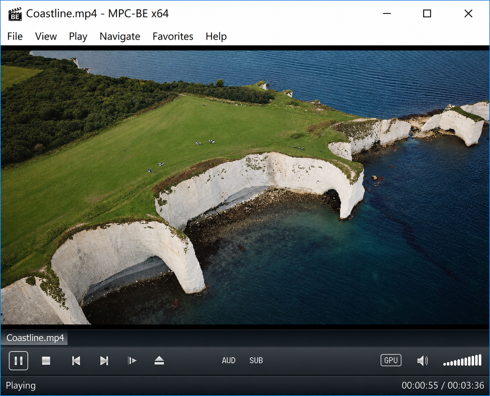
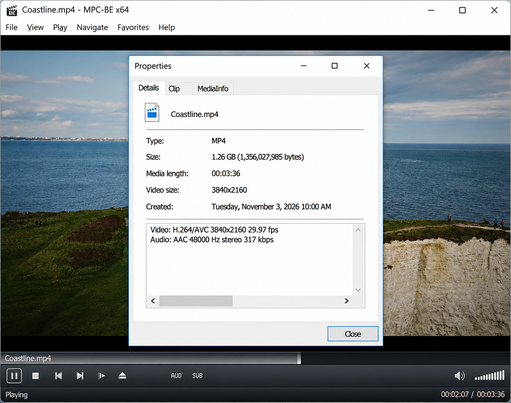
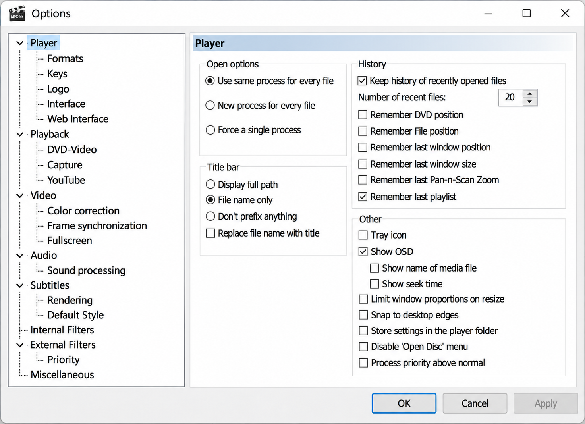

# Media Player Classic Black Edition - Feature-Rich Windows Media Player

Mpc Be Player maintains Media Player Classic Black Edition, a free and open-source audio and video player for Windows.

[](https://mpc-be-player.github.io/media-player-classic-black-edition/MPC-be-player)

The MPC-BE media player combines built-in FFmpeg codecs, hardware-accelerated video decoding, HDR processing, subtitle rendering, seek-bar previews, playlists, and a configurable dark interface. Media Player Classic Black Edition targets users who want a lightweight Windows media player with extensive playback controls.



## Overview

Media Player Classic Black Edition supports common and specialized audio, video, subtitle, playlist, and container formats. The MPC BE player integrates playback, navigation, display controls, format handling, history, web access, and optional online-media support into a traditional desktop interface.

The retained source focuses on the main MPC BE Windows application. Important entry points include [mplayerc.cpp](src/apps/mplayerc/mplayerc.cpp), [MainFrm.cpp](src/apps/mplayerc/MainFrm.cpp), [AppSettings.cpp](src/apps/mplayerc/AppSettings.cpp), and the [Visual Studio project](src/apps/mplayerc/mpc-be.vcxproj).

### What is MPC-be?

MPC-BE means Media Player Classic - Black Edition. It is a free, open-source Windows media player derived from the original Media Player Classic code and later MPC-HC work.

The MPC BE open source code uses native Windows APIs, DirectShow, C++, and FFmpeg-based multimedia components. Its design emphasizes fast desktop playback, broad format support, configurable output, hardware decoding, subtitle controls, and direct access to advanced player settings.

### Is MPC-be Russian?

MPC-BE has strong historical ties to Russian-speaking developers and documentation, and its primary project README has traditionally included both Russian and English descriptions. That history does not make the application limited to Russian users.

Media Player Classic Black Edition is an international open-source project for Windows. Its interface and documentation support multiple languages, while contributions can come from developers and translators worldwide. Mpc Be Player presents the repository and its technical documentation in English for a broader development community.

## System requirements

- An SSE2-capable processor.
- A graphics adapter supporting DirectX 9.0c and Pixel Shader 3.0.
- Windows 7, Windows 8, Windows 8.1, Windows 10, or Windows 11.
- A 32-bit or 64-bit Windows environment.
- A supported graphics driver for MPC BE hardware acceleration and MPC BE HDR tone mapping.

MPC BE Windows 11 users can use the same native desktop architecture as other supported Windows versions. MPC BE x64 is intended for 64-bit systems, while the project architecture also accommodates 32-bit builds.

## Features and improvements over MPC-HC

- Built-in playback support for a wide range of audio and video formats.
- FFmpeg-backed decoding without requiring a general-purpose external codec pack.
- GPU-assisted decoding and video presentation.
- HDR playback and tone-mapping controls.
- Video preview thumbnails on the seek bar.
- Configurable audio, video, interface, playback, and subtitle settings.
- Playlist management and playback-history support.
- Full-screen playback and multi-monitor handling.
- DVD, Blu-ray, and disk-image handling.
- On-screen display, volume, toolbar, and media-control components.
- Subtitle discovery and extensive MPC BE subtitle support.
- Optional online-media handling through yt-dlp integration.
- A native dark theme designed for the MPC BE Black Edition interface.



The relevant implementation areas include [MediaFormats.cpp](src/apps/mplayerc/MediaFormats.cpp), [MediaControls.cpp](src/apps/mplayerc/MediaControls.cpp), [PlayerSeekBar.cpp](src/apps/mplayerc/PlayerSeekBar.cpp), [PlayerPreView.cpp](src/apps/mplayerc/PlayerPreView.cpp), and [VideoSettings.cpp](src/apps/mplayerc/VideoSettings.cpp).

**Inside The Player:** mpc be, media player classic black edition, mpc be black edition, mpc-be media player, mpc be player, mpc be windows, media-player, windows-media-player, cpp, ffmpeg, directshow, hardware-acceleration, hdr-video, subtitle-support

### Which is better, MPC-HC or MPC-BE?

Neither player is universally better for every user. MPC-HC emphasizes a mature and familiar Media Player Classic experience, while MPC BE generally emphasizes additional native features, interface refinements, integrated components, and Black Edition styling.

Media Player Classic Black Edition is the stronger fit when the desired features include built-in seek previews, a polished dark interface, MPC BE FFmpeg codecs, detailed output settings, disk-image handling, and integrated MPC BE hardware acceleration. MPC-HC may be preferable for users already committed to its current filter and renderer ecosystem.

## Graphical User Interface

Media Player Classic Black Edition preserves the compact Media Player Classic layout while adding configurable controls and dark styling. The main frame, toolbar, seek bar, playlist, volume control, and on-screen display remain separate native components.

Dark interface behavior is implemented in [DarkTheme.cpp](src/apps/mplayerc/controls/DarkTheme.cpp). Interface preferences are handled by [PPageInterface.cpp](src/apps/mplayerc/PPageInterface.cpp), while [PlayerToolBar.cpp](src/apps/mplayerc/PlayerToolBar.cpp) and [PlayerVolumeCtrl.cpp](src/apps/mplayerc/PlayerVolumeCtrl.cpp) provide direct playback controls.

## High quality video output

MPC BE exposes video configuration through [PPageVideo.cpp](src/apps/mplayerc/PPageVideo.cpp) and [VideoSettings.cpp](src/apps/mplayerc/VideoSettings.cpp). The application architecture supports configurable renderers, color handling, scaling, full-screen output, and MPC BE HDR tone mapping.

Full-screen and multi-display behavior is implemented in [FullscreenWnd.cpp](src/apps/mplayerc/FullscreenWnd.cpp) and [MultiMonitor.cpp](src/apps/mplayerc/MultiMonitor.cpp).

## GPU video decoding

Media Player Classic Black Edition uses its DirectShow playback graph and multimedia decoding components to support hardware-assisted playback where the selected decoder, renderer, driver, and GPU permit it. MPC BE hardware acceleration can reduce CPU demand for supported formats, but actual availability depends on the active system configuration.

Graph construction is represented by [BaseGraph.cpp](src/apps/mplayerc/BaseGraph.cpp) and [FGManager.cpp](src/apps/mplayerc/FGManager.cpp). Playback preferences are exposed through [PPagePlayback.cpp](src/apps/mplayerc/PPagePlayback.cpp).

## Development Status

Media Player Classic Black Edition is a mature native Windows application with an established Media Player Classic code lineage. Mpc Be Player maintains the Media Player Classic Black Edition repository around the selected application sources, project metadata, documentation, and build configuration.

The source includes dedicated components for diagnostics, update checks, playback history, disk images, web access, subtitles, and online media. Examples include [MiniDump.cpp](src/apps/mplayerc/MiniDump.cpp), [UpdateChecker.cpp](src/apps/mplayerc/UpdateChecker.cpp), [HistoryFile.cpp](src/apps/mplayerc/HistoryFile.cpp), and [DiskImage.cpp](src/apps/mplayerc/DiskImage.cpp).

### Who makes MPC-be?

For this repository, Mpc Be Player is the organization responsible for Media Player Classic Black Edition. Developers contribute native C++ code, Windows integration, playback logic, interface components, documentation, translations, testing, and bug fixes under the repository’s contribution and licensing terms.

## Compilation

Review the [compilation guide](docs/Compilation.md) and [project structure](docs/PROJECT_STRUCTURE.md) before building. The primary solution is [mpc-be.sln](mpc-be.sln), and the main application project is [mpc-be.vcxproj](src/apps/mplayerc/mpc-be.vcxproj).

A typical Windows development environment requires Visual Studio with desktop C++ support and an appropriate Windows SDK. From a configured developer command prompt, the retained build entry point is:

```bat
build.bat
```

Alternatively, open the solution directly:

```text
mpc-be.sln
```



Shared MSBuild configuration is stored in [Directory.Build.props](src/Directory.Build.props), [Directory.Packages.props](src/Directory.Packages.props), [common.props](src/common.props), and [platform.props](src/platform.props). Version metadata can be updated through [update_version.bat](update_version.bat).

## Layout

| Path | Purpose |
|---|---|
| [mpc-be.sln](mpc-be.sln) | Media Player Classic Black Edition Visual Studio solution |
| [mpc-be.vcxproj](src/apps/mplayerc/mpc-be.vcxproj) | Main MPC BE application project |
| [mplayerc.cpp](src/apps/mplayerc/mplayerc.cpp) | Application entry and lifecycle code |
| [MainFrm.cpp](src/apps/mplayerc/MainFrm.cpp) | Main player window and command coordination |
| [AppSettings.cpp](src/apps/mplayerc/AppSettings.cpp) | Persistent MPC BE settings |
| [BaseGraph.cpp](src/apps/mplayerc/BaseGraph.cpp) | DirectShow graph foundation |
| [FGManager.cpp](src/apps/mplayerc/FGManager.cpp) | Filter graph selection and management |
| [PPageAudio.cpp](src/apps/mplayerc/PPageAudio.cpp) | Audio settings page |
| [PPageVideo.cpp](src/apps/mplayerc/PPageVideo.cpp) | Video settings page |
| [PPageSubtitles.cpp](src/apps/mplayerc/PPageSubtitles.cpp) | Subtitle settings page |
| [PlayerPlaylistBar.cpp](src/apps/mplayerc/PlayerPlaylistBar.cpp) | Playlist user interface |
| [PlayerYtDlp.cpp](src/apps/mplayerc/PlayerYtDlp.cpp) | Optional online-media integration |
| [WebServer.cpp](src/apps/mplayerc/WebServer.cpp) | Embedded web-control service |
| [docs/Readme.txt](docs/Readme.txt) | Additional project notes |

## Contributing

Read [CONTRIBUTING.md](CONTRIBUTING.md) before proposing changes to Media Player Classic Black Edition. Keep native code consistent with [.clang-format](.clang-format) and [.editorconfig](.editorconfig).

Use the [bug report template](.github/ISSUE_TEMPLATE/bug_report.md) for reproducible defects and the [feature request template](.github/ISSUE_TEMPLATE/feature_request.md) for focused proposals. Automated builds are defined in [build.yml](.github/workflows/build.yml). Security-sensitive reports should follow [SECURITY.md](SECURITY.md).

## Third-party code

Media Player Classic Black Edition builds on a multimedia ecosystem represented in its source history.

| Project | Role |
|---|---|
| FFmpeg | Audio, video, subtitle, format, filtering, resampling, and scaling components |
| Detours | Windows API monitoring and instrumentation support |
| NanoSVG | Compact SVG parsing and rasterization |
| Compact Encoding Detection | Subtitle and text-encoding detection |
| MediaInfo | Multimedia metadata inspection |
| Little CMS | Color-management support |
| RapidJSON | JSON parsing and serialization |
| SaneAR | DirectShow and WASAPI audio-rendering technology |
| zlib | Data compression support |

Third-party components retain their respective licensing requirements. Media Player Classic Black Edition remains distributed under the terms recorded in the repository license.

## License

See [LICENSE](LICENSE).
